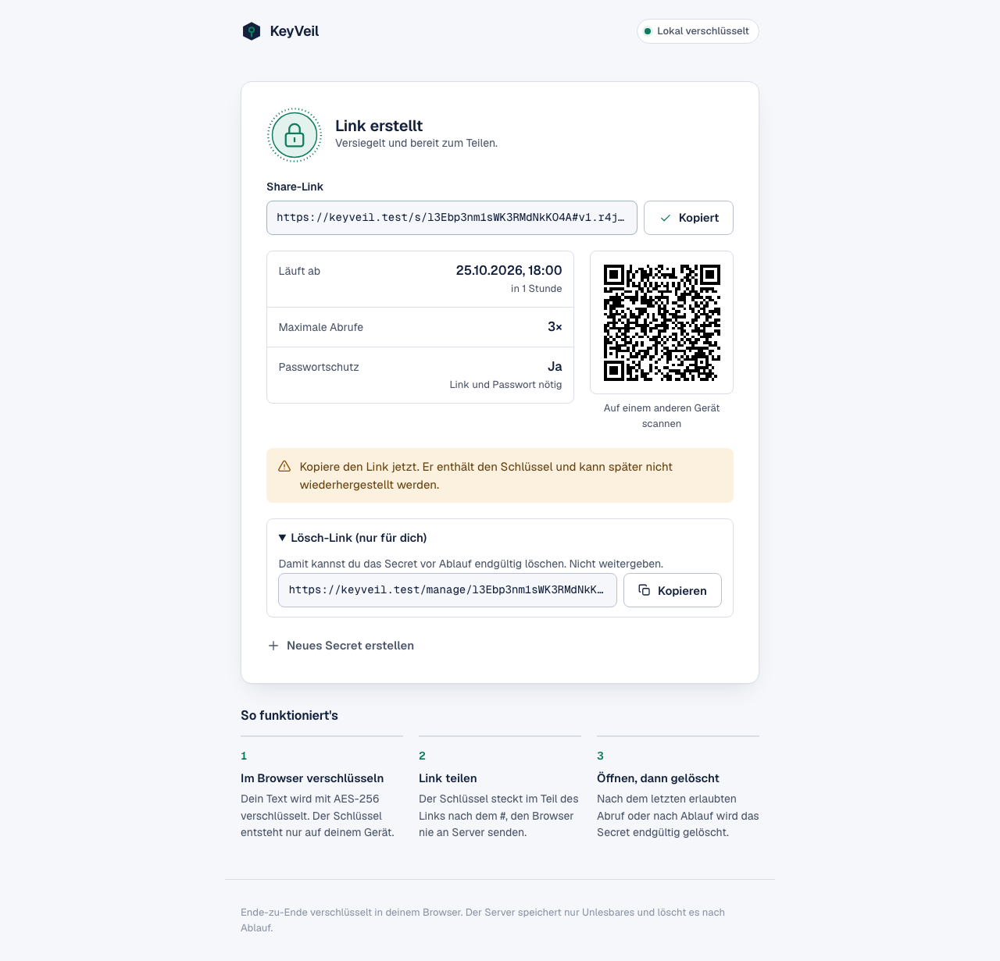
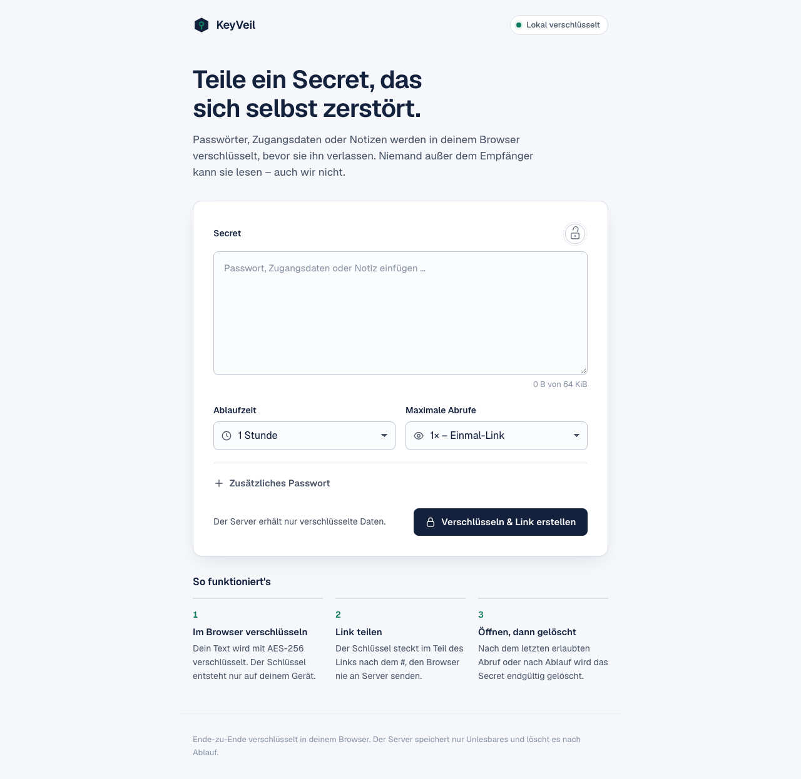
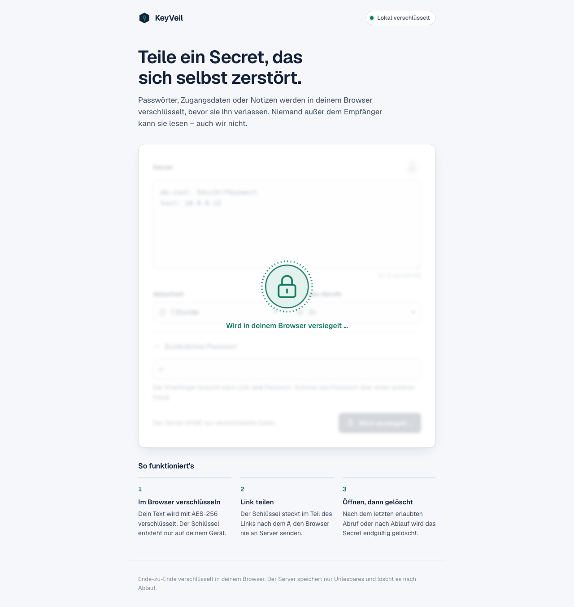
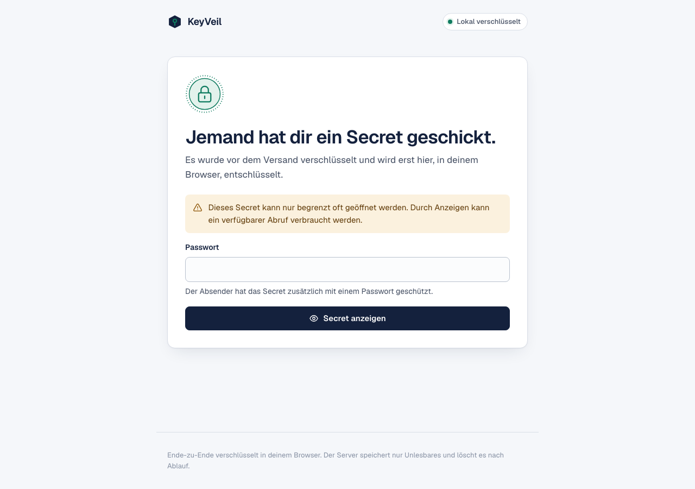
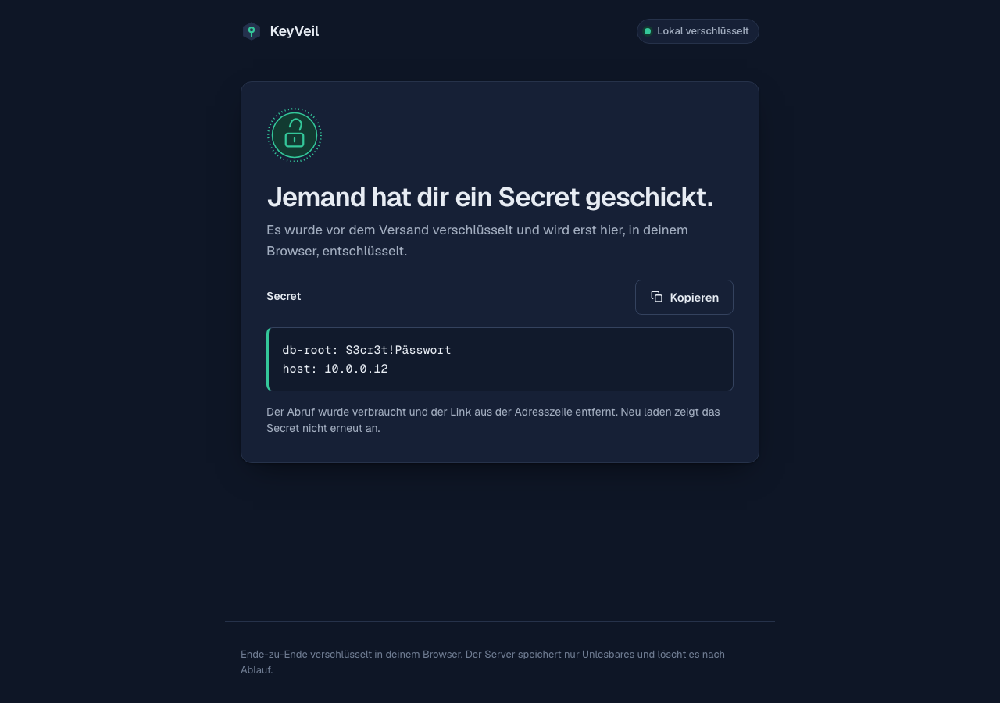
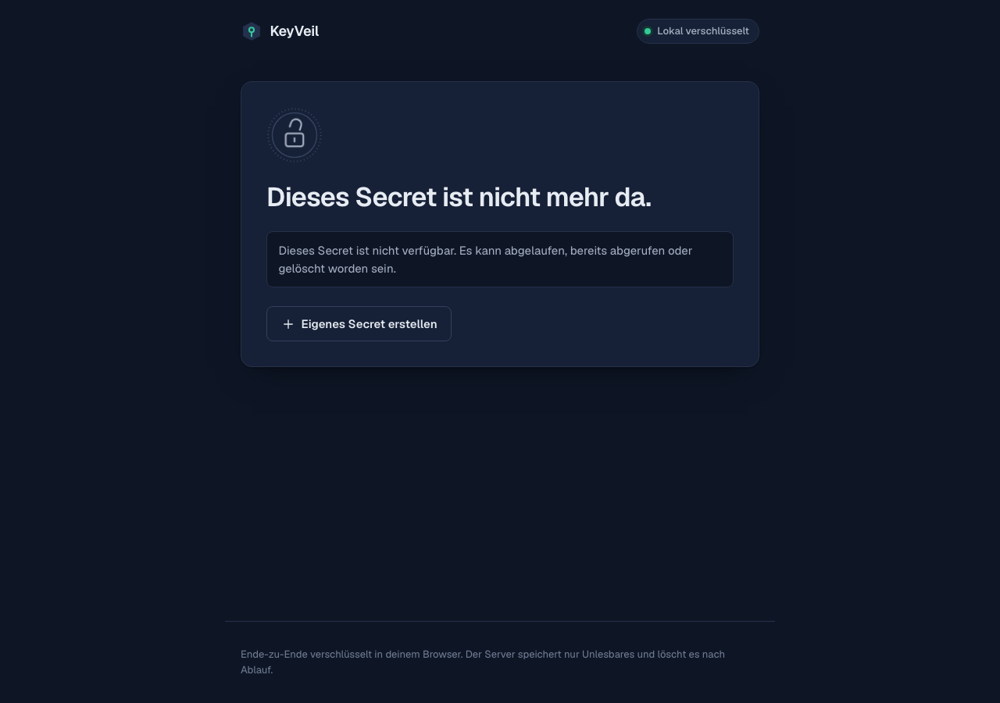
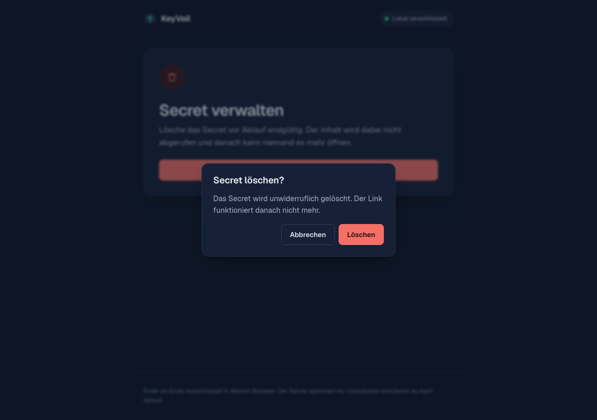

# KeyVeil

**Share passwords and other short secrets through a link that works once – encrypted in your browser before anything leaves it.**

[](https://github.com/Smart-HV/Keyveil/actions/workflows/tests.yml)
[](LICENSE)

<picture>
    <source media="(prefers-color-scheme: dark)" srcset="screenshots/03-link-created-desktop-dark.png">
    
</picture>

KeyVeil is a self-hosted, zero-knowledge secret sharing app built with Laravel and plain TypeScript. The server only ever stores ciphertext and a few lifecycle fields. The decryption key travels in the URL fragment (`#…`), which browsers never send to a server.

> [!NOTE]
> The user interface is currently in **German**. Translations are welcome – see [Contributing](CONTRIBUTING.md).

> [!IMPORTANT]
> KeyVeil has an extensive automated test suite but has **not yet had an independent security audit**. Review [the threat model](docs/threat-model.md) before you rely on it.

## How it works

```
 Sender's browser                    Server (Laravel)              Recipient's browser
 ────────────────                    ────────────────              ───────────────────
 plaintext + random key
 AES-256-GCM encrypt  ── ciphertext ──▶ stores ciphertext,
                                        expiry, view limit
 link: /s/<id>#v1.<key>  ─────── shared out of band ───────────▶  opens link (GET = nothing consumed)
                                                                   clicks "Secret anzeigen"
                                        ◀── POST /claim ─────────
                                        row lock, count view,
                                        delete on last view ────▶  decrypts locally with #key
```

- **Key in the fragment only.** The part after `#` is never part of an HTTP request, so the server cannot see it – not even in access logs.
- **Optional password.** Derived with Argon2id in the browser and combined with the link key via HKDF. The server never sees it.
- **Burn after reading.** A claim consumes one view inside a PostgreSQL row lock; the last allowed view deletes the row before the response is sent.
- **Link previews don't burn secrets.** Opening the page loads only the UI; a view is consumed only by an explicit click.

The full, normative protocol is in [docs/crypto-protocol-v1.md](docs/crypto-protocol-v1.md).

## Features

- Client-side end-to-end encryption (AES-256-GCM, HKDF-SHA-256, Argon2id via WebCrypto plus one small WASM dependency)
- Expiry from 5 minutes to 7 days, 1–10 views, one-time link by default
- Optional additional password
- Delete link for the sender, stored only as a hash of a hash
- QR code generated locally
- Uniform "not available" responses (no difference between unknown, expired, used or deleted)
- Strict Content Security Policy without `unsafe-inline`, `no-store`, `no-referrer`, HSTS
- No analytics, no third-party requests, no service worker, no browser storage
- Per-IP rate limits, payload size limits, automatic cleanup every minute
- Light and dark mode, responsive, keyboard accessible, respects reduced motion
- [Easy rebranding](docs/theming.md): name, logo, colors and fonts

## Screenshots

| Create                                                        | Sealing                                                                      | Open                                                                    |
| ------------------------------------------------------------- | ---------------------------------------------------------------------------- | ----------------------------------------------------------------------- |
|    |  |  |
| **Revealed**                                                  | **Unavailable**                                                              | **Delete**                                                              |
|  |    |           |

Mobile and dark variants of every screen are in [`screenshots/`](screenshots).

## Requirements

- PHP 8.3+ with `pdo_pgsql`
- PostgreSQL 15+
- Redis (production: rate limits and scheduler lock)
- Node.js 22+ (build only)
- HTTPS in production (WebCrypto requires a secure context)

## Quick start (local)

```bash
git clone https://github.com/Smart-HV/Keyveil.git keyveil
cd keyveil
createdb keyveil
cp .env.example .env            # adjust DB_USERNAME / DB_PASSWORD
composer setup                  # install, key:generate, migrate, npm install, build
composer run dev                # app + Vite dev server
```

Then open the URL printed by `composer run dev` (or your Laravel Herd / Valet domain).

## Configuration

All settings live in `.env`; see [`.env.example`](.env.example).

| Variable                                            | Default         | Purpose                                                                |
| --------------------------------------------------- | --------------- | ---------------------------------------------------------------------- |
| `APP_NAME`                                          | `KeyVeil`       | Name shown in the header and page titles                               |
| `BRAND_LOGO` / `BRAND_FAVICON` / `BRAND_SHOW_NAME`  | built-in        | Custom logo and favicon (files in `public/`)                           |
| `SECRET_MIN_TTL_SECONDS` / `SECRET_MAX_TTL_SECONDS` | `60` / `604800` | Allowed expiry range                                                   |
| `SECRET_MAX_VIEWS`                                  | `10`            | Highest selectable view limit                                          |
| `SECRET_MAX_ENVELOPE_BYTES`                         | `131072`        | Max encrypted payload size                                             |
| `SECRET_CREATE_PER_MINUTE` / `_PER_HOUR`            | `5` / `20`      | Create rate limit per IP                                               |
| `SECRET_CLAIM_PER_MINUTE`                           | `30`            | Claim rate limit per IP                                                |
| `SECRET_DELETE_PER_MINUTE`                          | `10`            | Delete rate limit per IP                                               |
| `TRUSTED_PROXIES`                                   | –               | Proxy IPs/CIDRs so rate limits and HTTPS detection see the real client |

Crypto parameters are deliberately **not** configurable at runtime; they are versioned in the protocol.

## Production

Read [docs/operations.md](docs/operations.md) before deploying. In short:

- Serve over HTTPS only, behind a reverse proxy that logs paths without query strings
- `APP_ENV=production`, `APP_DEBUG=false`, `CACHE_STORE=redis`, `SESSION_SECURE_COOKIE=true`
- Run the scheduler (`php artisan schedule:run` every minute) to purge expired secrets
- Build assets in CI and deploy the artifact; keep PostgreSQL and Redis off the public network
- Encrypt backups and keep retention short – deleted secrets may survive in old backups (encrypted, without keys)

## Rebranding

Name and logo via `.env`, colors and fonts in a single file, [`resources/css/theme.css`](resources/css/theme.css). Step-by-step guide: [docs/theming.md](docs/theming.md).

## Testing

```bash
php artisan test --compact     # Pest: API, security headers, logging, PostgreSQL concurrency
npm test                       # Vitest: crypto protocol, golden vectors, fragment parsing
npx playwright install         # once
npm run e2e                    # Playwright: Chromium, Firefox, WebKit
```

The test database is `keyveil_testing` (see `phpunit.xml`); E2E uses `keyveil_e2e`. Golden test vectors in [`tests/fixtures`](tests/fixtures) are generated with PHP (OpenSSL, libsodium) and verified byte-for-byte by the TypeScript implementation.

## Security

- [Security policy and how to report a vulnerability](SECURITY.md) – please do not open public issues for security problems
- [Threat model](docs/threat-model.md): what KeyVeil protects against, and what it does not
- [Privacy and data flow](docs/privacy-data-flow.md)

The most important limitation of any browser-based encryption: whoever controls the server could ship modified JavaScript. Self-host from a reviewed release, keep dependencies minimal (two runtime packages: `hash-wasm`, `uqr`) and build in CI.

## Tech stack

Laravel 13 · PostgreSQL · Redis · Blade · TypeScript · Vite · WebCrypto · hash-wasm (Argon2id) · uqr (QR) · Pest · Vitest · Playwright

## Contributing

Contributions are welcome – see [CONTRIBUTING.md](CONTRIBUTING.md).

## License

[Apache License 2.0](LICENSE) © Smart-HV
